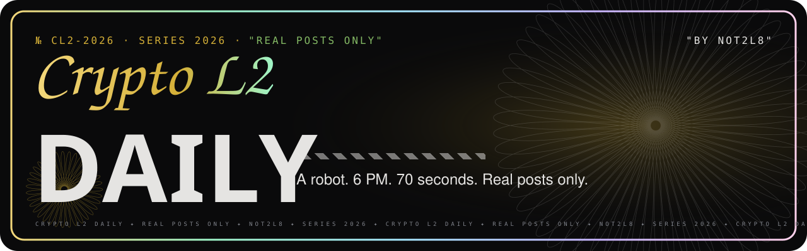
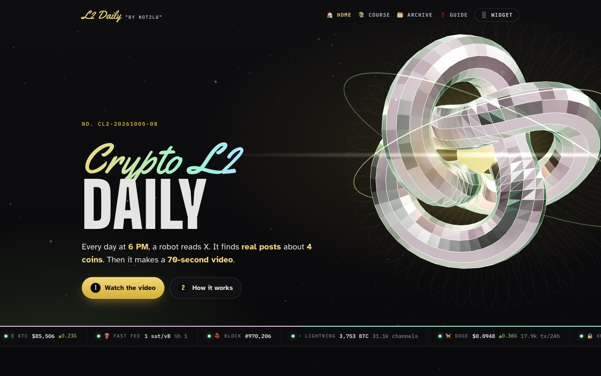
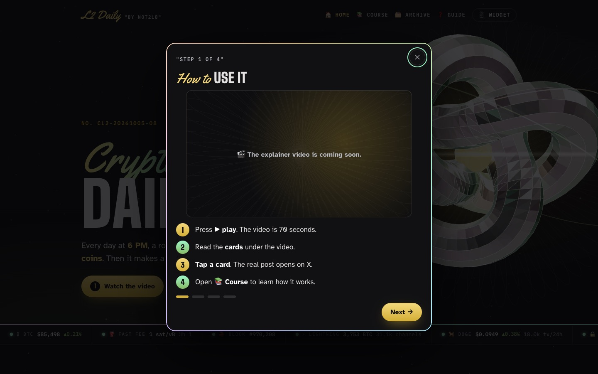
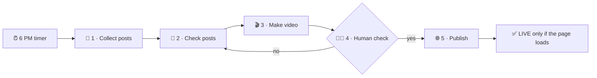
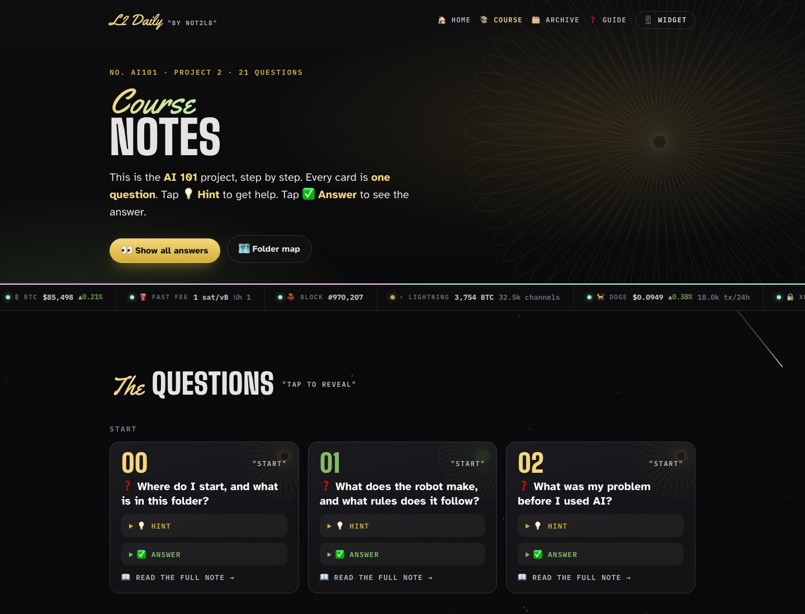
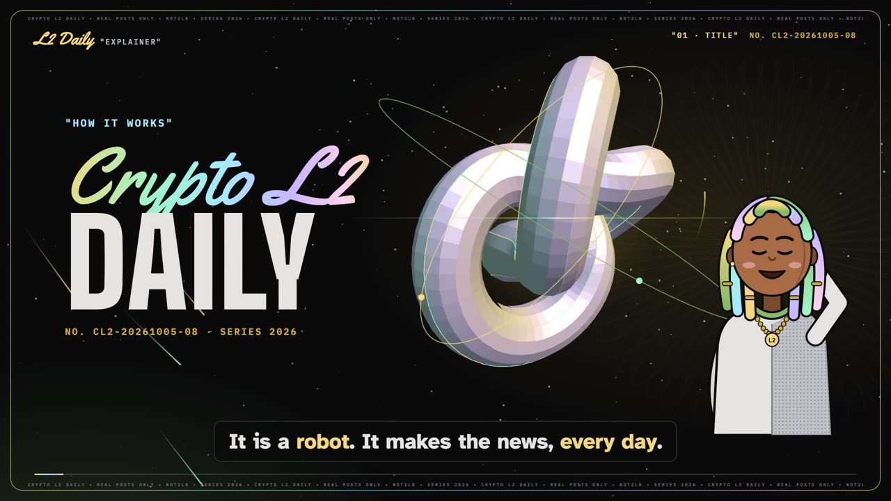

<p align="center">
  
</p>

<p align="center">
  <a href="https://not2l8-l2-daily.vercel.app/"></a>
  <a href="https://not2l8-l2-daily.vercel.app/course/"></a>
  <a href="https://cornishlikeadam.github.io/crypto-l2-daily/"></a>
</p>
<p align="center">
  
  
  
  
  
</p>

# 💵 Crypto L2 Daily

> [!IMPORTANT]
> ⭐ **The one rule:** every card is a **real post** from X. It shows **who** posted, **when**, and a **link**. The robot **never makes up news**.

**What it is:** a robot that makes a **70-second video** every day at **6 PM** (New York time).
**What it shows:** real posts from the **last 24 hours** about **4 coins** and their add-ons.

| ⚡ Bitcoin | 🐕 Dogecoin | 🔒 Monero | 🪙 Litecoin |
|:---:|:---:|:---:|:---:|
| Lightning, Ark, sidechains | community, layer 2s | FCMP++ and CARROT | Lightning and MWEB |

<p align="center">
  
  
</p>

---

## 🔢 1. How to use the site

1. ▶️ **Watch.** Press play. The video is **70 seconds**.
2. 🃏 **Read.** Read the cards under the video. **One card = one real post.**
3. 👆 **Tap.** Tap a card. The **real post** opens on X.
4. 🔤 **Learn.** Open the [word list](https://not2l8-l2-daily.vercel.app/course/glossary/). It explains the crypto words.
5. 📚 **Study.** Open the [course](https://not2l8-l2-daily.vercel.app/course/). Tap **💡 Hint**. Then tap **✅ Answer**.

> [!TIP]
> 🧭 New here? Press **❓ Guide** at the top of the site. It shows **4 short pages**: how to use it, what it does, the core, and the widget.

---

## ⚙️ 2. The core: what happens at 6 PM



| # | 🧩 Step | ⚙️ What happens | 📁 File |
|:---:|---|---|---|
| **01** | 🔎 **Collect** | The robot searches X **4 times**, once per coin. It keeps the **top 25** posts. | `scripts/collect_x.py` |
| **02** | 🧹 **Check** | It **removes** wrong-day posts, price guesses, ads, giveaways, tiny accounts and copies. It keeps **up to 3** per coin. | `scripts/collect_x.py` |
| **03** | 🎬 **Make** | It makes **8–10 cards**. A free voice (**Piper**) reads them. The video is **exactly 70 seconds**. | `scripts/render.py`, `remotion/` |
| **04** | 🧑‍⚖️ **Human check** | **I** approved the first video. After that, the robot publishes by itself. | `scripts/approve_sample.sh` |
| **05** | 🌐 **Publish** | It builds the site, saves a **GitHub** backup and sends it to **Vercel**. It checks that the page **loads**. | `scripts/build_site.py`, `scripts/lib.sh` |

> [!WARNING]
> 🛑 If any step fails, the robot **stops**. It publishes **nothing**. A broken day never becomes a wrong video.

---

## 📚 3. The course hub (Obsidian ⇄ website)

The AI 101 notes live in [`vault/project-02/`](vault/project-02/). **Obsidian** and the **website** read **the same files**.

1. ✍️ **Write** a note in Obsidian.
2. 🏗️ The daily build **turns it into a web page**.
3. ❓ The site shows **each note as a question card**: 💡 **Hint** → ✅ **Answer** → 📖 **Full note**.

<p align="center"></p>

> [!NOTE]
> 🎨 The vault has its own **Black Platinum** theme for Obsidian: [`docs/obsidian/l2-daily.css`](docs/obsidian/l2-daily.css). Copy it to `.obsidian/snippets/`. Turn it on in **Settings → Appearance → CSS snippets**.

---

## 🏗️ 4. How it was built: generic vs. unique

Every **AI 101** workflow has the **same 5 parts**. This project uses that **generic** shape. The **unique** parts are on the right.

| # | 🧩 Generic part (AI 101) | 💎 What is unique here |
|:---:|---|---|
| 01 | ⏰ **Trigger** | **6 PM** New York time. The Mac's **cron** timer starts `scripts/daily.sh`. |
| 02 | 📥 **Context** | **4 coin searches** and a list of **"remove it" rules**. The **date check** is rule 1. |
| 03 | ⚙️ **Task** | Pick **3 posts per coin**. Make **8–10 cards**. Fit the voice into **70 seconds**. |
| 04 | 📦 **Output** | A **video**, a **site**, **course pages**, a **feed** and a **phone-widget file**. |
| 05 | 🧑‍⚖️ **Human check** | **I** approved the first video. I check every **archive day**. |

📖 Full breakdown, feature by feature: [`vault/project-02/how-it-was-built.md`](vault/project-02/how-it-was-built.md)

---

## 🎨 5. The design: Black Platinum


| 💎 Detail | 🎯 Where you see it |
|---|---|
| 💵 **Banknote art:** guilloche rosettes, microprint, serial numbers (`NO. CL2-20261005-08`), big denomination numbers | step tiles, cards, footer, video |
| 🌈 **Holographic foil** | card edges, the video frame, the 3D knot, the ribbon |
| 🏷️ **"QUOTED" labels** and **stripe tape** (industrial streetwear details) | section headers, dividers |
| ✒️ **Calligraphy** (Yellowtail) + **bold capitals** (Big Shoulders) | every title |
| 👀 **Atkinson Hyperlegible** (made to be easy to read) | all body text |

---

## 📱 6. The phone widget (test feature)

A small card for your iPhone Home Screen. It shows the **Bitcoin price**, the **fee** and **today's top 3 posts**.

1. 📲 Install the free **Scriptable** app. Open it one time.
2. ⬇️ Download [`scriptable.js`](https://not2l8-l2-daily.vercel.app/scriptable.js).
3. 📁 In **Files**, move it into **iCloud Drive › Scriptable**.
4. ➕ Hold the Home Screen. Tap **+**. Choose **Scriptable**. Tap **Add**.
5. ✏️ Hold the widget. Tap **Edit Widget**. Choose the script.

> [!NOTE]
> 🤖 Android: point any JSON widget app at [`widget.json`](https://not2l8-l2-daily.vercel.app/widget.json).

---

## 🎬 7. The explainer video

<p align="center">
  <a href="https://not2l8-l2-daily.vercel.app/assets/explainer.mp4"></a><br>
  <b>▶ <a href="https://not2l8-l2-daily.vercel.app/assets/explainer.mp4">Watch the explainer (90 s)</a></b> · it also plays in the site's <b>❓ Guide</b>
</p>

> [!TIP]
> 🎥 A **90-second** explainer: **3Blue1Brown-style 3D** math animation + **Japanese-American manga** style.
> The full prompt and the **8-shot** plan are in [`vault/project-02/explainer-video.md`](vault/project-02/explainer-video.md).

1. 🎬 **It is built in code.** `scripts/make_explainer.py` makes the voice (Piper), the music and the timing.
2. 🎞️ The animation is in `remotion/explainer/` (3D knot, the Guide, 8 shots).
3. 🔁 **Rebuild it** with: `../OpenMontage/.venv/bin/python scripts/make_explainer.py`

---

## 🗂️ 8. What is in this repo

```text
crypto-l2-daily/
├── 📜 scripts/
│   ├── daily.sh            ⏰ the 6 PM run (steps 1 → 5)
│   ├── collect_x.py        🔎 step 1 + 🧹 step 2
│   ├── render.py           🎬 step 3 (calls OpenMontage)
│   ├── build_site.py       🏗️ step 5: builds every page
│   ├── site_theme.py       🎨 the Black Platinum look, 3D hero, live numbers, guide
│   ├── course_pages.py     📚 turns the vault into the course hub
│   ├── lib.sh              🚀 publish: GitHub + Vercel + "is it live?"
│   ├── approve_sample.sh   🧑‍⚖️ step 4: the human approval
│   ├── backfill.sh         🗂️ add an old day to the archive
│   ├── set_x_cookies.sh    🍪 save the X login codes (hidden)
│   └── set_voice.sh        🎙️ save the voice settings (hidden)
├── 🎞️ remotion/            the video card design
├── 🧠 vault/project-02/    the AI 101 notes (Obsidian)
├── 🌐 site/                the built website
├── 🧾 data/                the checked posts for each day
├── ⚙️ config/              approval switch + archive notes
└── 📘 docs/                banner, screenshots, Obsidian theme
```

---

## 🧑‍⚖️ 9. Approval

`config/pipeline.json` has the switch `human_approval_default`.

- 🟡 **`true`:** the run **stops** before it publishes. **Do this:** run `scripts/approve_sample.sh YYYY-MM-DD`. It records the approval, sets the switch to `false`, and publishes.
- 🟢 **`false`:** every daily run publishes by itself.

---

## 🔑 Fix the 6 PM GitHub push (one time)

> [!WARNING]
> 🔒 The 6 PM timer (cron) **cannot open the macOS Keychain**. So it cannot get your GitHub login, and the **backup push fails**. The site still goes live on Vercel.

**Do this one time** in Terminal. It saves your GitHub login in a private file that only you can read:

```bash
gh auth token > ~/crypto-l2-daily/.gh_token && chmod 600 ~/crypto-l2-daily/.gh_token
```

- 🙈 `.gh_token` is in `.gitignore`. It **never** goes to GitHub.
- 🔁 If you log out of `gh`, run the command again.

---

## 📄 10. License note

> [!NOTE]
> 🎬 **OpenMontage** (AGPLv3) lives in `../OpenMontage`. This repo **calls** it. It does **not copy** it.
> 🎞️ `remotion/` is **original code**. It needs only the `remotion` npm packages from OpenMontage's composer.

<p align="center"><sub>✒️ <b>NOT2L8</b> · <i>Not Too Late. Always Forward.</i> · SERIES 2026</sub></p>
