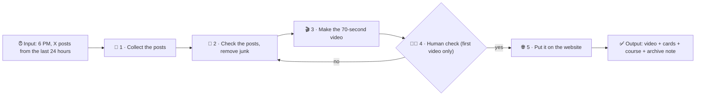

# 🗺️ The workflow map: Crypto L2 Daily

## 🔢 The same map in words

1. ⏰ **Input:** at 6 PM, the robot gets X posts from the last 24 hours.
2. 🔎 **Step 1:** collect the posts.
3. 🧹 **Step 2:** check the posts. Remove the junk.
4. 🎬 **Step 3:** make the 70-second video.
5. 🧑‍⚖️ **Step 4:** I check it. **Yes** → go to step 5. **No** → go back to step 2.
6. 🌐 **Step 5:** put it on the website.
7. ✅ **Output:** the video, the cards, the course pages and the archive note.

> [!tip] 🧩 Open the canvas
> `process-map.canvas` shows the **same 5 steps** in the **same order**. Open it in Obsidian.
